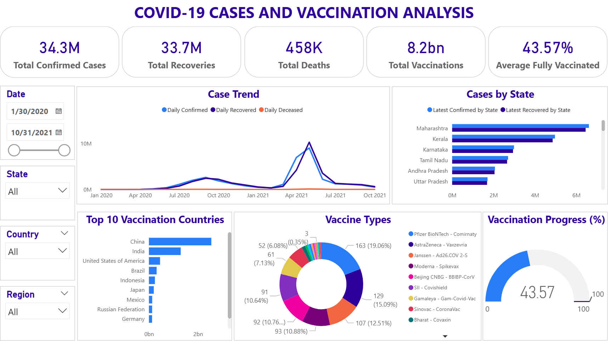

# **Project Type:** Internship Project – GROWAI
# COVID-19 Cases & Vaccination Analysis — Power BI

## Project Overview

How severely was India affected by COVID-19, which states recorded the highest case counts, and how did vaccination progress across countries?

This project analyzes COVID-19 cases, recoveries, deaths, state-wise impact, global vaccination counts, and recorded vaccine types using **Power BI**.

The dashboard combines Indian COVID-19 case data with global vaccination data to provide an interactive overview of pandemic trends and vaccination patterns.

The project was completed as part of my **GROWAI Data Analyst Internship** using Power BI.

## Business Problem

During the COVID-19 pandemic, understanding infection trends, identifying highly affected states, and reviewing vaccination progress were important for public-health planning.

This project brings together COVID-19 case information and global vaccination records in one interactive dashboard, making the information easier to explore and compare.

## Project Objectives

- Analyze daily COVID-19 case trends over time.
- Compare confirmed cases and recoveries across Indian states.
- Identify the top 10 countries by total vaccination counts.
- Explore the distribution of recorded vaccine types.
- Review average fully vaccinated percentages across countries.
- Provide interactive filtering through dashboard slicers.

## My Role

As a **Data Analyst Intern at GROWAI**, I worked with three datasets covering daily COVID-19 trends, Indian state-wise cases, and global vaccination records.

My responsibilities included data understanding, cleaning and transformation, data modeling, DAX calculations, dashboard development, and presenting key findings.

## Tools & Technologies

| Tool | Purpose |
|---|---|
| Power BI Desktop | Dashboard development and visualization |
| Power Query | Data cleaning and transformation |
| DAX | KPI and measure calculations |
| CSV | Source datasets |

## Analysis Workflow

1. **Data Understanding:** Examined three datasets containing daily COVID-19 trends, Indian state-level cases, and global vaccination information.
2. **Data Cleaning:** Checked column names, data types, missing values, and duplicate records.
3. **Data Transformation:** Used Power Query to standardize date fields, trim vaccine names, and split vaccine information into separate rows.
4. **Data Modeling:** Created a relationship between the COVID-19 case trend and state-wise datasets using their date fields. Created a one-to-many relationship between the country-level vaccination table and the vaccine types table.
5. **DAX Calculations:** Created measures for India's latest confirmed cases, recoveries, and deaths, along with average fully vaccinated percentage. Used the vaccination total for the total vaccination KPI.
6. **Dashboard Development:** Built an interactive dashboard using KPI cards, charts, a gauge, and slicers.

## Key KPIs

| KPI | Value | Description |
|---|---:|---|
| Total Confirmed Cases (India) | **34.3M** | India's cumulative confirmed cases on the latest available date. |
| Total Recoveries (India) | **33.7M** | India's cumulative recoveries on the latest available date. |
| Total Deaths (India) | **458K** | India's cumulative deaths on the latest available date. |
| Total Vaccinations (Across Countries) | **8.2bn** | Total recorded vaccination doses across 228 countries. |
| Average Fully Vaccinated | **43.57%** | Arithmetic average of available country-level fully vaccinated percentages; not population-weighted. |

The first three KPIs represent India's latest cumulative totals in the available state-wise data. The vaccination KPIs summarize the country-level vaccination dataset.

## Key Findings

- **COVID-19 Cases:** India recorded approximately **34.3 million confirmed cases, 33.7 million recoveries, and 458,000 deaths** in the latest available state-wise data.
- **State-wise Impact:** Maharashtra recorded the highest confirmed case count among Indian states, with **6,611,078 confirmed cases** and **6,450,585 recoveries** in the latest state-wise figures.
- **Daily Case Trend:** In **May 2021**, the daily case trend data recorded a total of **9,016,687 confirmed cases, 10,266,501 recoveries, and 120,072 deaths** for the month.
- **Vaccination Counts:** The global vaccination dataset recorded approximately **8.2 billion vaccination doses** across 228 countries.
- **Country Comparison:** China ranked first in the Top 10 Vaccinations chart, with **2,543,206,400 recorded vaccination doses**.
- **Vaccine Types:** Pfizer-BioNTech – Comirnaty was the most frequently recorded vaccine type in the chart, with **163 country-vaccine entries (19.06%)**.
- **Vaccination Progress:** The average country-level fully vaccinated percentage was **43.57%**.

*Note: Vaccination doses represent recorded doses, not unique vaccinated people. Vaccine-type entries represent country-vaccine records, not doses administered.*

## Dashboard Features

### 1. Case Trend

A line chart comparing daily confirmed cases, recoveries, and deaths over time in India.

### 2. Cases by State

A horizontal bar chart comparing the latest available confirmed cases and recoveries across Indian states.

### 3. Top 10 Vaccinations

A horizontal bar chart displaying the top 10 countries based on their total recorded vaccination doses.

### 4. Vaccine Types

A donut chart showing the distribution of recorded vaccine types based on country-vaccine entries.

### 5. Vaccination Progress (%)

A gauge displaying the average fully vaccinated percentage across countries against a 100% reference level.

## Interactive Filters

The dashboard includes four slicers:

- **Date:** Explore COVID-19 case trends over a selected period.
- **State:** Filter Indian state-level case information.
- **Country:** Explore country-level vaccination information.
- **Region:** Compare vaccination information across WHO regions.

These filters make it easier to explore the relevant dashboard visuals from different perspectives.

## Data Model

The Power BI report uses the following relationships:

| Primary Table | Related Table | Relationship |
|---|---|---|
| `case_time_series - case_time_series[Date_YMD]` | `raw_data_indian_states[Date]` | One-to-many |
| `vaccination-data[COUNTRY]` | `Vaccine_Types[COUNTRY]` | One-to-many |

The `Vaccine_Types` table is a separate Power Query reference query created from the `vaccination-data` table by splitting vaccine names into individual rows.

## Dashboard Preview



*The dashboard combines COVID-19 case trends, state-wise comparisons, vaccination counts, vaccine types, and vaccination progress in one interactive view.*

**Power BI file:** [Download COVID-19_Dashboard.pbix](PowerBI/COVID-19_Dashboard.pbix)

## What I Achieved

Developed an interactive Power BI dashboard combining Indian COVID-19 case information and global vaccination data. The dashboard allows users to compare state-wise case counts, explore daily trends, identify countries with high vaccination counts, and examine recorded vaccine types and vaccination percentages.

## Business Recommendations

Based on the findings, public-health teams could:

- Review healthcare resource requirements in states with high confirmed case counts, such as Maharashtra.
- Compare daily confirmed cases, recoveries, and deaths to identify periods requiring greater public-health attention.
- Compare vaccination counts and coverage across countries to identify differences in vaccination patterns.
- Use country-level vaccination information to support further public-health planning.
- Review infection trends and vaccination coverage together rather than relying on a single KPI.

These are proposed uses of the analysis, not measured improvements in public-health outcomes.

## Challenges & Solutions

**Challenge:** The project involved three datasets with different structures and levels of detail.

**Solution:** Used Power Query to clean and transform the datasets, standardize date fields, and split vaccine information into separate rows. Created appropriate relationships to organize the data for dashboard analysis.

**Challenge:** The vaccination dataset contained multiple vaccine names in a single field.

**Solution:** Created a separate `Vaccine_Types` query by splitting the vaccine names at commas, trimming spaces, and removing blank entries. This made it possible to visualize individual vaccine types.

## Limitations

- The COVID-19 case data covers the available period from **January 30, 2020, to October 31, 2021**.
- The `Tested` column in the state-level dataset contained approximately 69% missing values.
- Some vaccination fields contained blank values, which were preserved rather than automatically replaced with zero.
- The 43.57% fully vaccinated KPI is an average of available country-level percentages, not a population-weighted global rate.
- Total vaccination counts represent recorded doses, not the number of unique vaccinated people.
- Vaccine Types counts represent country-vaccine entries, not doses administered.
- The analysis describes recorded patterns and does not establish the causes of changes in COVID-19 cases or vaccination coverage.

## Future Enhancements

- Include more recent COVID-19 and vaccination data.
- Add testing trends when more complete testing data is available.
- Compare vaccination coverage with population-level information.
- Include additional public-health indicators for a broader view of pandemic impact.
- Improve the dashboard with additional time-based comparisons.

## Project Structure

```text
COVID-19-Cases-and-Vaccination-Analysis/
│
├── Dataset/
│   ├── case_time_series - case_time_series.csv
│   ├── raw_data_indian_states.csv
│   └── vaccination_data.csv
│
├── PowerBI/
│   └── COVID-19_Dashboard.pbix
│
├── Dashboard/
│   └── COVID-19_Dashboard.png
│
├── README.md
├── Business_Insights.md
├── Data_Dictionary.md
└── Cleaning_Log.md
```

## How to View the Project

1. Download the `COVID-19_Dashboard.pbix` file.
2. Open it using Power BI Desktop.
3. Use the dashboard slicers to explore the available information.

The dashboard screenshot is available in the `Dashboard` folder.

## Conclusion

This project provides an interactive overview of COVID-19 cases in India and global vaccination patterns.

It highlights the scale of the pandemic, differences in state-wise case counts, daily case trends, vaccination counts across countries, and the distribution of recorded vaccine types.

The dashboard demonstrates how Power BI, Power Query, and DAX can be used to transform multiple datasets into an interactive report that supports data exploration and public-health planning.
